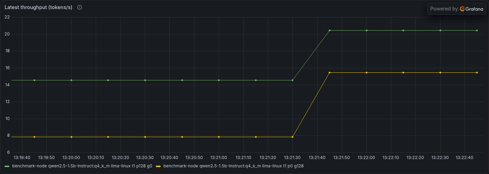
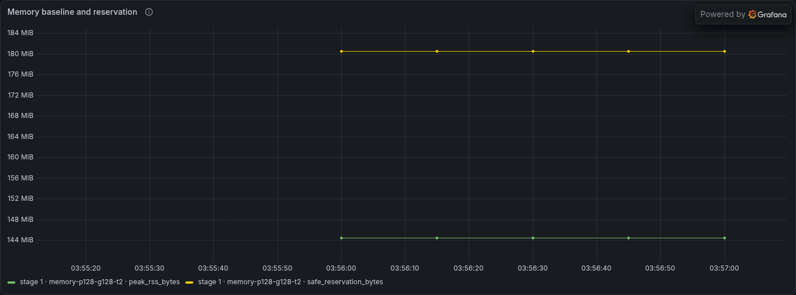
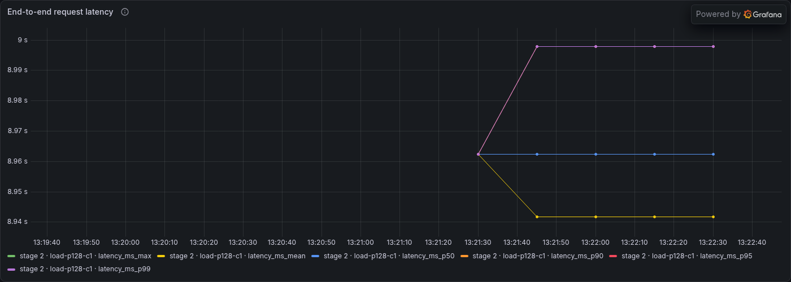
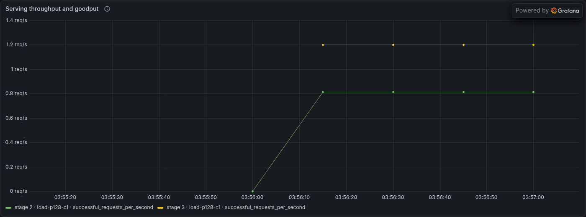
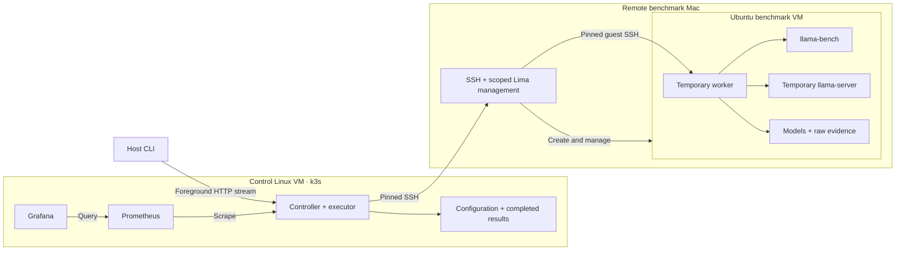

# 📊 ModelGauge

Benchmark GGUF models in a Linux VM on your Mac or another Mac over SSH. Measure **throughput, request latency, and resource use**, watch live Grafana dashboards, and export results before deployment.

One Go executable manages one control VM, one benchmark VM, and one selected model. Install multiple models and compare them sequentially using the same YAML workload. Commands run in the foreground; there is no application database, job queue, or automatic recovery. **Run one command at a time**—execution locks do not prevent overlapping commands.

## 🚀 Install

**On the computer running the CLI:** Go 1.23.6+, Git, and Make to build; Lima (`limactl` on PATH with working virtualization) to run the control VM. Internet access is required for images, dependencies, and models. Docker Desktop is not required.

**For a remote benchmark Mac:** macOS 13.5+, hardware virtualization, Remote Login enabled for your account, and network access from the controller. Keep it awake with its lid open. Defaults require at least 32 GiB free disk and enough RAM for a 3 GiB VM plus macOS. ModelGauge installs Lima and the worker remotely; no Homebrew, Go, or manual VM preparation is needed there.

```sh
git clone https://github.com/ashwat287/modelGauge.git
cd modelGauge
make build
make test
make install
export PATH="$HOME/.local/bin:$PATH"
```

`make install` installs to `~/.local/bin`; override with `BINDIR=/your/bin`. Keep the PATH export in your shell profile. The installed binary bundles Linux workers, macOS management helpers, and deployment assets for Intel/AMD64 and ARM64. It works after deleting the checkout; copy any example YAML you want to keep first. Go, Git, and Make are only needed again when rebuilding.

## 🏗️ Set up

From the checkout, copy the [small validation plan](examples/remote-smoke.yaml) into a working directory:

```sh
mkdir -p "$HOME/modelgauge-lab"
cp examples/remote-smoke.yaml "$HOME/modelgauge-lab/benchmark.yaml"
cd "$HOME/modelgauge-lab"
```

Choose **one** mode for the workspace. Setup provisions infrastructure; it is separate from installing the CLI and needs no source checkout.

### Local: both VMs on this Mac

```sh
modelgauge setup
```

### Remote: benchmark VM on another Mac

```sh
modelgauge setup --remote-host your-user@192.168.1.50
```

Verify the printed host-key fingerprint, type `yes`, and enter the SSH password at the hidden prompt. The target Mac's public fingerprint can be checked there with `ssh-keygen -lf /etc/ssh/ssh_host_ed25519_key.pub`.

For key authentication or a custom SSH port:

```sh
modelgauge setup --remote-host your-user@192.168.1.50:2222 \
  --identity /path/to/private-key \
  --host-key SHA256:YOUR_VERIFIED_FINGERPRINT
```

`--identity` accepts an unencrypted bootstrap private key; omit it to use the password prompt. `--host-key` skips the trust prompt only when the fingerprint matches. Supplied passwords and bootstrap private keys are not saved; the controller stores dedicated scoped keys for subsequent operations.

The **control VM** installs private, checksum-verified Lima, creates a pinned Ubuntu 24.04 VM, and prepares CPU-only llama.cpp and the Linux worker. Execution goes through the Mac into the guest over SSH. The guest SSH port stays on loopback; the Mac's SSH server must allow TCP forwarding. Personal Lima instances and host directories are not shared with the benchmark VM.

| VM | CPUs | RAM | Disk | Location |
|---|---:|---:|---:|---|
| `modelgauge-control` | 4 | 6 GiB | 50 GiB | Computer running the CLI |
| `benchmark-node` | 2 | 3 GiB | 30 GiB | Same computer, or remote Mac |

Local defaults allocate **9 GiB on one computer**, which is unsuitable for an 8 GiB laptop. Remote mode splits the allocations between machines. Leave host OS headroom on both. Override resources for new VMs, for example:

```sh
modelgauge setup --remote-host your-user@192.168.1.50 \
  --control-memory 4 --node-memory 3 --node-cpus 2 --node-disk 30
```

Resource flags do not resize existing VMs. Subsequent `modelgauge setup` reuses the configured mode and target. Export needed results and run `modelgauge cleanup --delete-vms` before switching modes. Private local configuration lives in `~/.config/modelgauge/`; remote ownership and execution credentials are retained by the controller.

For source updates, rebuild with `make install` and rerun setup while idle. For a remote target, repeat the `setup --remote-host ...` command with login credentials to update its management helper too. Legacy PostgreSQL history is not migrated; export and clean up with the previous version first.

## 🧪 Install a model and benchmark

Start with the pinned **SmolLM2-135M Instruct Q4_K_M** model (~105 MB). With the example copied above:

```sh
modelgauge model install smollm2-135m-instruct:q4_k_m
modelgauge validate benchmark.yaml &&
modelgauge run benchmark.yaml
```

Installation downloads on the benchmark node, verifies the checksum, selects the model, and waits for completion. The small example tests threads 1/2, a 128-token prompt, three direct repetitions, and three serving requests with a 32-token output cap. It validates the workflow; use longer runs to assess stability and deployment capacity.

To try a larger catalog model:

```sh
modelgauge model search qwen
modelgauge model install qwen2.5-1.5b-instruct:q4_k_m
```

The catalog also provides Qwen2.5 1.5B Instruct Q5_K_M and Q8_0. Each successful install selects that model. Both local and remote modes use the same commands and plans. For your own GGUF, supply its HTTPS URL and SHA-256:

```sh
modelgauge model install my-model:q4 --url "$MODEL_URL" --sha256 "$MODEL_SHA256"
```

For a longer workload, replace `benchmark.yaml` with:

```yaml
apiVersion: modelgauge.io/v1alpha1
kind: Benchmark
metadata:
  name: baseline
spec:
  threads: [1, 2]
  contexts: [512]
  stages:
    - profile: standard-cpu
      options:
        warmups: 3
        repetitions: 5
    - profile: node-serving
      options:
        warmups: 2
      config:
        suite: basic
        concurrency: [1, 2]
        requests: 10
        output_tokens: 128
```

```sh
modelgauge validate benchmark.yaml &&
modelgauge run benchmark.yaml
```

`validate` resolves the selected model/node and previews the plan. `run` executes stages in order, opens Grafana automatically in interactive terminals, and prints phase changes once:

```text
Benchmark: running
...warmup and measurement phases...
Measurements: completed; results saved
Cooldown: running (1m0s)
Cooldown: completed; live collection stopped
Benchmark: completed
Dashboard saved view: http://127.0.0.1:3000/d/modelgauge-live?...
```

Resource collection starts before warmup. After measurement, model processes stop and node observation continues for **60 seconds**, then ends automatically. The finished dashboard remains accessible with a fixed time range and refresh disabled. No Ctrl+C or separate monitoring command is needed.

| Profile | Workload |
|---|---|
| `standard-cpu` | Prompt processing at each context/thread setting, generation of 128 tokens, repeated throughput samples, and a separate peak-memory workload. |
| `node-serving` | A temporary loopback-only llama-server on the benchmark node: startup/shutdown, streaming requests, latency, capacity, outcomes, and available resource telemetry. |

For serving, `suite: basic` sweeps context and concurrency. `suite: deployment` adds sustained load (default 60 seconds), burst/probe, cache off/on or conversation cases, JSON-format checks, cancellation/probe, and idle/resume. Advanced `config.cases` replaces generated cases. Serving request counts use `config.requests`; `options.repetitions` applies to direct benchmarks.

To compare another installed model or capture JSON:

```sh
modelgauge model list
modelgauge model use smollm2-135m-instruct:q4_k_m
modelgauge run benchmark.yaml
modelgauge run benchmark.yaml --json > experiment.json
```

JSON mode sends progress to stderr, waits for cooldown, and does not open a browser. Errors return nonzero. Early interruption stops owned processes; interrupted work does not resume. Measurements already saved before cooldown remain available.

## 📏 Measurements and relevance

### Engine performance

| Measurement | Meaning and practical use |
|---|---|
| **Prompt tokens/s** | Prefill speed at each prompt length. At 32 tokens/s, processing 512 tokens takes roughly 16 seconds; this excludes the rest of a serving request. |
| **Generation tokens/s** | Output speed for 128 tokens from an empty prompt. At 4 tokens/s, generation takes roughly 32 seconds. Use serving tests to assess decoding after longer prompts. |
| **Standard deviation and scaling** | Repeated samples expose variability; thread/context sweeps reveal useful settings. Relative deviation is `stddev / mean`: 0.4 at a mean of 4 tokens/s is 10%. More threads need not be faster. |
| **Peak RSS and reservation** | GNU `time` measures a separate workload using the largest context and highest thread count, with generation set to 128. Suggested reservation is `ceil(1.25 × RSS)`—a heuristic, not a concurrent-serving guarantee. |

Warmups are excluded from scored throughput but do not guarantee thermal stability. Compare identical workloads under similar host load and power conditions.

### Serving responsiveness and capacity

Requests run locally on the benchmark node, so results include HTTP, server waiting/work, and generator overhead, but exclude the user's external network latency.

| Measurement | Meaning and relevance |
|---|---|
| **End-to-end latency / TTFT / first answer** | Time to complete the response, first productive streamed event, and first visible answer respectively. Distinguishes initial responsiveness from complete-answer speed. |
| **Time per output token (TPOT)** | `(last output event − TTFT) / (output tokens − 1)`, when token accounting is available. About 50 ms/token corresponds to 20 tokens/s after initial waiting. |
| **Chunk gaps, token gaps, longest stall** | Streaming smoothness. Chunks can contain multiple tokens; token gaps are reported only when individual boundaries and counts are usable. |
| **Dispatch delay / scheduled latency** | Generator lateness relative to intended arrival; scheduled latency includes that delay. These are not direct server queue-time measurements. |
| **Requests/s and aggregate tokens/s** | Successful requests and accounted input/output tokens per case duration. Combined throughput at concurrency 2 is not each user's speed. Token rates require usage for every success. |
| **Goodput** | Successful requests meeting configured latency targets and supplied output checks per second. Six qualifying requests in five seconds means 1.2 requests/s, even if ten requests completed. |
| **Outcomes and limits** | Offered/dispatched requests, successes, errors, timeouts, incomplete streams, cancellations, client drops, output caps, and reported context truncation. Read these alongside throughput; client drops are not server rejections. |
| **Cache and output checks** | Reported cached tokens/hits explain prefix reuse; text, regex, JSON, subset, and tool-call checks test supplied output requirements. These are not general model-quality scores. |

Timing summaries include count, mean, standard deviation, min/max, and p50/p90/p95/p99. A p95 of two seconds describes roughly 95% of observed samples; a few requests cannot establish production tail latency. Missing token/cache accounting means unavailable, not zero.

Enable goodput by adding targets under the serving stage's `config`:

```yaml
targets:
  ttft_ms: 2000
  tpot_ms: 100
  latency_ms: 20000
```

Deployment scenarios test concurrency tradeoffs, sustained drift, post-burst responsiveness, prefix reuse/conversation, output format, cancellation, and first requests after a five-second idle. Startup measures launch-to-ready, not controlled cold-disk loading. A recovery probe is one observation; client cancellation acknowledgement does not prove when backend computation stopped. Sustained windows group requests by completion.

### Resources

| Measurement | What it helps diagnose |
|---|---|
| **Process RSS/PSS, peaks, initial/final memory** | Resident memory and proportional shared-page cost. Sampling can miss spikes; lifetime peaks can include earlier cases, and growth alone does not prove a leak. |
| **CPU seconds, CPU %, CPU/success** | Compute demand and request cost; 200% means roughly two cores. Observation-window costs can include failed or other work. |
| **Process I/O, page faults, context switches** | Storage, paging, and scheduling pressure. Major faults may involve disk; minor faults do not require disk reads. |
| **Node CPU, available RAM, swap, disk** | Node headroom and contention. Changes in swap counters indicate paging; existing swap usage alone does not. |
| **Clock, temperature, CPU-package energy** | Correlates drift with available hardware sensors. Package energy includes background work, and a sensor reading alone does not establish throttling. |
| **GPU and runtime telemetry** | Conditional NVIDIA memory/utilization/power/temperature/clocks and sampled energy; available server queue/token/capacity metrics. Default CPU-only Lima VMs generally lack GPU telemetry. |

Energy per output token requires token accounting. Sensors describe their exposed scope, not necessarily model-only or whole-system usage. Unavailable telemetry stays missing. Linux VM measurements share the host's CPU, memory bandwidth, and thermal budget; they do not represent native macOS performance.

## 📈 Dashboards and results

Grafana opens without login using local anonymous **Viewer** access; administration remains authenticated. If automatic opening fails, use the printed URL. Panels include descriptions explaining units, relevance, and limitations.

| Dashboard | Contents |
|---|---|
| **Live experiment** | Model, phases, stage/case progress, freshness, throughput, memory, and primary serving results. |
| **Serving detail** | Latency distributions, stream smoothness, outcomes, goodput, cache/checks, and lifecycle probes. |
| **Resources** | Process/node resources and available thermal, energy, GPU, and runtime telemetry. |
| **Completed results / Infrastructure** | Retained measurements and monitored Linux-node health. |

Scraping and refresh each run every five seconds; allow roughly ten seconds or longer under load. Serving summaries are provisional until final. Direct throughput appears after an invocation completes, and GNU-time RSS after process exit. Flat retained-result lines do not mean continuous benchmarking.

Collection spans warmup, stage transitions, and cooldown. Process readings end at process exit; node graphs stop at the collection boundary. Grafana and Prometheus stay available. The saved-view URL preserves time bounds, but relies on Prometheus history: **seven-day retention and a 2 GB storage cap**. Export evidence to retain it longer. Controller restarts clear transient live state, while completed result files persist.

### Grafana examples

Captured from the **Live experiment** dashboard for the validated **SmolLM2-135M Instruct Q4_K_M** run on the remote Mac's Linux VM. The selected window is **24 November 2026, 22:25:12–22:27:09 UTC**; screenshot axes show **25 November, 03:55–03:57 IST**. Flat segments retain measured results through cooldown; they are not new benchmark samples.

**Direct throughput:** prompt processing and generation at one and two threads. Compare like workloads; prompt tokens/s and generation tokens/s describe different work.



**Memory baseline:** the separate memory workload's peak RSS and the 1.25× reservation estimate—about 144 MiB and 180 MiB here. The estimate is not a concurrent-serving guarantee.



**Serving response times:** p95 total latency and time to first token, plus TPOT in milliseconds per token. These answer different questions; three requests per case do not establish a reliable production p95.



**Serving throughput:** successful requests per second for the serving stages. Goodput is absent because this example has no configured service targets; an unavailable value is not zero.



### Inspect and export

```sh
modelgauge results
modelgauge results --json
modelgauge history
modelgauge results recommend --context 512 --memory-budget-gib 2
modelgauge export --output ./exports/baseline --include-raw
```

Results and exports default to the latest completed run; use `--experiment NAME` for history. The recommender selects measured direct settings with relative deviation at most 10% and checks the 1.25× RSS estimate against your budget. It does not grade quality or optimize serving concurrency.

Exports include JSON/CSV measurements, plans/results, metrics, a manifest, and checksums. `--include-raw` retrieves node evidence, including from remote VMs through the controller. Optional Prometheus-history flags are listed in `modelgauge export --help`.

## 🔌 Architecture

Remote mode:



In local mode, both VMs run on the CLI computer and the controller connects directly to the benchmark VM. In either mode, the Linux node needs neither k3s nor a resident agent. **llama-bench exits before llama-server starts**; they never run together. Measurements and progress return over SSH, while serving requests stay inside the benchmark VM, excluding inter-laptop network latency.

Owned processes are stopped and reaped on interruption or supervised connection loss. A temporary observer handles the 60-second cooldown, then exits; Grafana remains available.

Benchmark modules own planning, execution, reports, and metrics; platform code transports common plan/result envelopes. Completed configuration/results persist, but interrupted operations are not restored.

## 🧹 Cleanup and troubleshooting

Export evidence before cleanup: managed models/files can be removed even if VMs are kept, and VM deletion removes their entire disks. Host exports remain; reused and untracked VMs are preserved.

```sh
modelgauge cleanup --dry-run            # Preview only
modelgauge cleanup                      # Clean managed files/services; keep VMs
modelgauge cleanup --force              # Stop owned work, then clean
modelgauge cleanup --delete-vms         # Also delete ModelGauge-created VMs
modelgauge cleanup --force --delete-vms # Stop owned work and delete created VMs
```

Remote resources are cleaned before the local controller. With `--delete-vms`, cleanup also removes the owned remote VM, private Lima installation, and management key; the Mac and unrelated files/VMs are preserved. Without VM deletion, the remote management installation is retained with the VM. An unreachable remote Mac blocks cleanup so the controller and ownership records remain available.

Cleanup prints plain text; add `--json` for scripts. Active work causes an error suggesting `--force`. Force retains ownership/identity checks and does not stop unrelated processes or expand deletion scope; stopping managed work requires a reachable controller. Checks are best-effort, so avoid concurrent commands.

| Problem | Action |
|---|---|
| `flag provided but not defined: -remote-host` | Run `make install` from the updated checkout; check `command -v modelgauge` and `modelgauge setup --help`. |
| SSH connection timeout | Keep the target awake, confirm Remote Login and network access, and try its current IP instead of `.local`. A TCP timeout happens before password authentication. |
| Host-key mismatch | Verify the target's identity before proceeding; do not bypass the check. |
| No selected model | Run `modelgauge model install MODEL` or select an installed model with `modelgauge model use MODEL`. |

After fixing a VM/network problem, verify or refresh its connection, then rerun the interrupted command:

```sh
modelgauge node reconnect
```

Reconnect does not resume experiments. The remote connection can start its verified owned VM if stopped; a missing or broken VM needs setup or repair. See `modelgauge --help` and `<command> --help` for flags.
