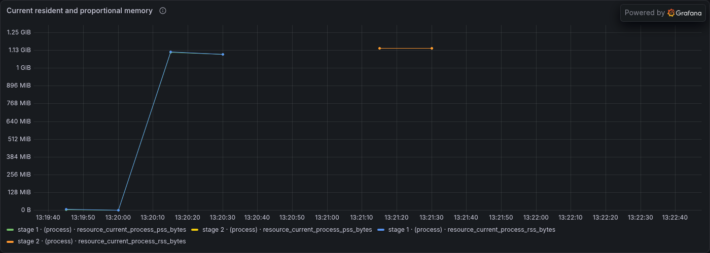
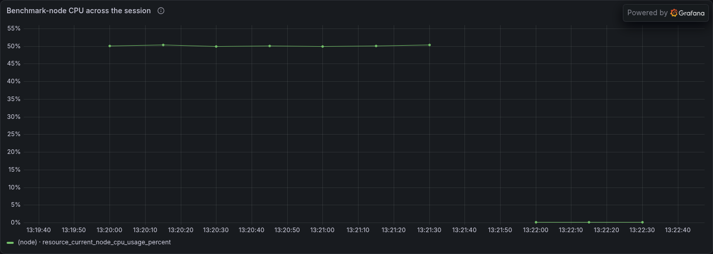
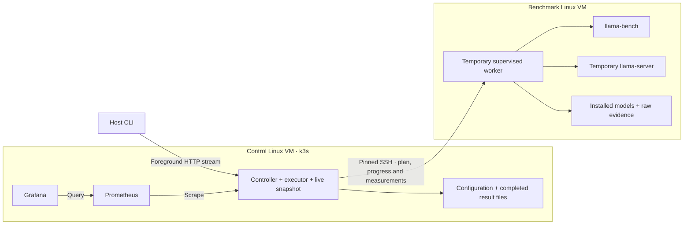

# 📊 ModelGauge

Benchmark GGUF models on a Linux node before deployment: measure **throughput, request latency, and resource use**, watch live Grafana dashboards, and export the evidence.

One Go executable manages one control VM, one benchmark VM, and one selected model. Install multiple models and compare them sequentially using the same YAML workload. Commands run in the foreground; there is no application database, job queue, or automatic recovery. **Run one command at a time**—execution locks do not prevent overlapping commands.

## 🚀 Install

**Build prerequisites:** Go 1.23.6+, Git, and Make. **Runtime prerequisites:** Lima (`limactl` on PATH with working virtualization) and internet access for VM images, dependencies, containers, and models. Docker Desktop is not required.

```sh
git clone https://github.com/ashwat287/modelGauge.git
cd modelGauge
make build
make test
make install
export PATH="$HOME/.local/bin:$PATH"
```

`make install` installs to `~/.local/bin`; override with `BINDIR=/your/bin`. Keep the PATH export in your shell profile. The installed binary bundles Linux ARM64/AMD64 runtimes and deployment assets, so it works after deleting the checkout, without host Go, Git, or Make.

## 🏗️ Set up

```sh
mkdir -p "$HOME/modelgauge-lab"
cd "$HOME/modelgauge-lab"
modelgauge setup
```

Setup provisions services and builds pinned CPU-only llama.cpp binaries in the benchmark VM. It is separate from installing the CLI and needs no source checkout.

| Default VM | CPUs | RAM | Disk |
|---|---:|---:|---:|
| `modelgauge-control` | 4 | 6 GiB | 50 GiB |
| `benchmark-node` | 2 | 3 GiB | 30 GiB |

Allow host memory **beyond the 9 GiB allocated to VMs**; these defaults are unsuitable for an 8 GiB laptop. To change allocations for newly created VMs:

```sh
modelgauge setup --control-memory 4 --node-memory 4 --node-cpus 2
```

Flags do not resize existing VMs. Private configuration and ownership records live in `~/.config/modelgauge/`. For upgrades, reinstall from source and rerun setup while idle. Legacy PostgreSQL workspaces require export and cleanup with the previous version; history is not migrated.

### Benchmark on another Mac over SSH

On the target Mac, enable **Remote Login**, allow your account, and keep the Mac awake and reachable. The supported remote setup requires macOS 13.5+, hardware virtualization, internet access, and enough free disk for the VM. You do not need to install Lima, Homebrew, Go, or ModelGauge there.

```sh
modelgauge setup --remote-host your-user@192.168.1.50
```

Verify the printed SSH host-key fingerprint and enter the SSH password at the hidden prompt. For key authentication, add `--identity /path/to/private-key` (an unencrypted bootstrap key); `--host-key SHA256:...` supplies an already verified fingerprint without the trust prompt. Credentials are used once and are not saved; dedicated scoped keys are kept privately by the controller.

The control VM installs pinned Lima in a private directory on the remote Mac, creates a pinned Ubuntu 24.04 **2-vCPU / 3-GiB / 30-GiB VM**, and prepares its worker and llama.cpp. No personal Lima VMs or host-directory mounts are used. Both host and guest SSH keys are pinned. The controller connects through the Mac, so the guest SSH port stays on loopback; the Mac's SSH server must allow TCP forwarding. Subsequent `modelgauge setup` reuses the remote target. Clean up the existing workspace before switching between local and remote nodes.

Start with the pinned **SmolLM2-135M Instruct Q4_K_M** model (~105 MB) and copy [examples/remote-smoke.yaml](examples/remote-smoke.yaml) into your working directory as `benchmark.yaml`:

```sh
modelgauge model install smollm2-135m-instruct:q4_k_m
modelgauge validate benchmark.yaml
modelgauge run benchmark.yaml
modelgauge export --output ./exports/remote-smoke --include-raw
```

The example tests both benchmark stages, threads 1/2, a 128-token prompt, and three short serving requests. Dashboards and the 60-second cooldown work as usual. Results describe the Linux VM, not native macOS. `cleanup --delete-vms` also removes the owned remote VM and private installation; unrelated files and VMs remain intact. An unreachable remote Mac blocks cleanup before the controller is removed.

## 🧪 Install a model and benchmark

```sh
modelgauge model search qwen
modelgauge model install qwen2.5-1.5b-instruct:q4_k_m
```

Installation downloads on the node, verifies the checksum, and selects the model when complete. The catalog includes Qwen2.5 1.5B Instruct Q4_K_M, Q5_K_M, and Q8_0. For another compatible GGUF:

```sh
modelgauge model install my-model:q4 --url "$MODEL_URL" --sha256 "$MODEL_SHA256"
```

Save `benchmark.yaml` outside the checkout:

```yaml
apiVersion: modelgauge.io/v1alpha1
kind: Benchmark
metadata:
  name: baseline
spec:
  threads: [1, 2]
  contexts: [512]
  stages:
    - profile: standard-cpu
      options:
        warmups: 3
        repetitions: 5
    - profile: node-serving
      options:
        warmups: 2
      config:
        suite: basic
        concurrency: [1, 2]
        requests: 10
        output_tokens: 128
```

```sh
modelgauge validate benchmark.yaml &&
modelgauge run benchmark.yaml
```

`validate` resolves the selected model/node and previews the plan. `run` executes stages in order, opens Grafana automatically in interactive terminals, and prints phase changes once:

```text
Benchmark: running
...warmup and measurement phases...
Measurements: completed; results saved
Cooldown: running (1m0s)
Cooldown: completed; live collection stopped
Benchmark: completed
Dashboard saved view: http://127.0.0.1:3000/d/modelgauge-live?...
```

Resource collection starts before warmup. After measurement, model processes stop and node observation continues for **60 seconds**, then ends automatically. The finished dashboard remains accessible with a fixed time range and refresh disabled. No Ctrl+C or separate monitoring command is needed.

| Profile | Workload |
|---|---|
| `standard-cpu` | Prompt processing at each context/thread setting, generation of 128 tokens, repeated throughput samples, and a separate peak-memory workload. |
| `node-serving` | A temporary loopback-only llama-server on the benchmark node: startup/shutdown, streaming requests, latency, capacity, outcomes, and available resource telemetry. |

For serving, `suite: basic` sweeps context and concurrency. `suite: deployment` adds sustained load (default 60 seconds), burst/probe, cache off/on or conversation cases, JSON-format checks, cancellation/probe, and idle/resume. Advanced `config.cases` replaces generated cases. Serving request counts use `config.requests`; `options.repetitions` applies to direct benchmarks.

To compare another installed model or capture JSON:

```sh
modelgauge model list
modelgauge model use qwen2.5-1.5b-instruct:q5_k_m
modelgauge run benchmark.yaml
modelgauge run benchmark.yaml --json > experiment.json
```

JSON mode sends progress to stderr, waits for cooldown, and does not open a browser. Errors return nonzero. Early interruption stops owned processes; interrupted work does not resume. Measurements already saved before cooldown remain available.

## 📏 Measurements and relevance

### Engine performance

| Measurement | Meaning and practical use |
|---|---|
| **Prompt tokens/s** | Prefill speed at each prompt length. At 32 tokens/s, processing 512 tokens takes roughly 16 seconds; this excludes the rest of a serving request. |
| **Generation tokens/s** | Output speed for 128 tokens from an empty prompt. At 4 tokens/s, generation takes roughly 32 seconds. Use serving tests to assess decoding after longer prompts. |
| **Standard deviation and scaling** | Repeated samples expose variability; thread/context sweeps reveal useful settings. Relative deviation is `stddev / mean`: 0.4 at a mean of 4 tokens/s is 10%. More threads need not be faster. |
| **Peak RSS and reservation** | GNU `time` measures a separate workload using the largest context and highest thread count, with generation set to 128. Suggested reservation is `ceil(1.25 × RSS)`—a heuristic, not a concurrent-serving guarantee. |

Warmups are excluded from scored throughput but do not guarantee thermal stability. Compare identical workloads under similar host load and power conditions.

### Serving responsiveness and capacity

Requests run locally on the benchmark node, so results include HTTP, server waiting/work, and generator overhead, but exclude the user's external network latency.

| Measurement | Meaning and relevance |
|---|---|
| **End-to-end latency / TTFT / first answer** | Time to complete the response, first productive streamed event, and first visible answer respectively. Distinguishes initial responsiveness from complete-answer speed. |
| **Time per output token (TPOT)** | `(last output event − TTFT) / (output tokens − 1)`, when token accounting is available. About 50 ms/token corresponds to 20 tokens/s after initial waiting. |
| **Chunk gaps, token gaps, longest stall** | Streaming smoothness. Chunks can contain multiple tokens; token gaps are reported only when individual boundaries and counts are usable. |
| **Dispatch delay / scheduled latency** | Generator lateness relative to intended arrival; scheduled latency includes that delay. These are not direct server queue-time measurements. |
| **Requests/s and aggregate tokens/s** | Successful requests and accounted input/output tokens per case duration. Combined throughput at concurrency 2 is not each user's speed. Token rates require usage for every success. |
| **Goodput** | Successful requests meeting configured latency targets and supplied output checks per second. Six qualifying requests in five seconds means 1.2 requests/s, even if ten requests completed. |
| **Outcomes and limits** | Offered/dispatched requests, successes, errors, timeouts, incomplete streams, cancellations, client drops, output caps, and reported context truncation. Read these alongside throughput; client drops are not server rejections. |
| **Cache and output checks** | Reported cached tokens/hits explain prefix reuse; text, regex, JSON, subset, and tool-call checks test supplied output requirements. These are not general model-quality scores. |

Timing summaries include count, mean, standard deviation, min/max, and p50/p90/p95/p99. A p95 of two seconds describes roughly 95% of observed samples; a few requests cannot establish production tail latency. Missing token/cache accounting means unavailable, not zero.

Enable goodput by adding targets under the serving stage's `config`:

```yaml
targets:
  ttft_ms: 2000
  tpot_ms: 100
  latency_ms: 20000
```

Deployment scenarios test concurrency tradeoffs, sustained drift, post-burst responsiveness, prefix reuse/conversation, output format, cancellation, and first requests after a five-second idle. Startup measures launch-to-ready, not controlled cold-disk loading. A recovery probe is one observation; client cancellation acknowledgement does not prove when backend computation stopped. Sustained windows group requests by completion.

### Resources

| Measurement | What it helps diagnose |
|---|---|
| **Process RSS/PSS, peaks, initial/final memory** | Resident memory and proportional shared-page cost. Sampling can miss spikes; lifetime peaks can include earlier cases, and growth alone does not prove a leak. |
| **CPU seconds, CPU %, CPU/success** | Compute demand and request cost; 200% means roughly two cores. Observation-window costs can include failed or other work. |
| **Process I/O, page faults, context switches** | Storage, paging, and scheduling pressure. Major faults may involve disk; minor faults do not require disk reads. |
| **Node CPU, available RAM, swap, disk** | Node headroom and contention. Changes in swap counters indicate paging; existing swap usage alone does not. |
| **Clock, temperature, CPU-package energy** | Correlates drift with available hardware sensors. Package energy includes background work, and a sensor reading alone does not establish throttling. |
| **GPU and runtime telemetry** | Conditional NVIDIA memory/utilization/power/temperature/clocks and sampled energy; available server queue/token/capacity metrics. Default CPU-only Lima VMs generally lack GPU telemetry. |

Energy per output token requires token accounting. Sensors describe their exposed scope, not necessarily model-only or whole-system usage. Unavailable telemetry stays missing. Linux VM measurements share the host's CPU, memory bandwidth, and thermal budget; they do not represent native macOS performance.

## 📈 Dashboards and results

Grafana opens without login using local anonymous **Viewer** access; administration remains authenticated. If automatic opening fails, use the printed URL. Panels include descriptions explaining units, relevance, and limitations.

| Dashboard | Contents |
|---|---|
| **Live experiment** | Model, phases, stage/case progress, freshness, throughput, memory, and primary serving results. |
| **Serving detail** | Latency distributions, stream smoothness, outcomes, goodput, cache/checks, and lifecycle probes. |
| **Resources** | Process/node resources and available thermal, energy, GPU, and runtime telemetry. |
| **Completed results / Infrastructure** | Retained measurements and monitored Linux-node health. |

Scraping and refresh each run every five seconds; allow roughly ten seconds or longer under load. Serving summaries are provisional until final. Direct throughput appears after an invocation completes, and GNU-time RSS after process exit. Flat retained-result lines do not mean continuous benchmarking.

Collection spans warmup, stage transitions, and cooldown. Process readings end at process exit; node graphs stop at the collection boundary. Grafana and Prometheus stay available. The saved-view URL preserves time bounds, but relies on Prometheus history: **seven-day retention and a 2 GB storage cap**. Export evidence to retain it longer. Controller restarts clear transient live state, while completed result files persist.

### Grafana examples

Real Qwen2.5 1.5B Instruct Q4_K_M measurements from a Lima VM; times are UTC. Your results will differ.

**Throughput:** prompt processing and generation are separate workloads; steps represent newly completed results.


**Request latency:** complete-answer timing. Overlapping percentiles in this small run do not establish a reliable production p99.


**Process memory:** RSS/PSS by stage; readings end when each owned process exits. Missing samples remain gaps.



**Node CPU:** workload activity followed by cooldown. About 50% on two vCPUs corresponds to one fully occupied vCPU.



### Inspect and export

```sh
modelgauge results
modelgauge results --json
modelgauge history
modelgauge results recommend --context 512 --memory-budget-gib 2
modelgauge export --output ./exports/baseline --include-raw
```

Results and exports default to the latest completed run; use `--experiment NAME` for history. The recommender selects measured direct settings with relative deviation at most 10% and checks the 1.25× RSS estimate against your budget. It does not grade quality or optimize serving concurrency.

Exports include JSON/CSV measurements, plans/results, metrics, a manifest, and checksums. `--include-raw` retrieves node evidence. Optional Prometheus-history flags are listed in `modelgauge export --help`.

## 🔌 Architecture



For remote targets, SSH goes through the target Mac into its owned Linux VM; the controller also manages that VM over the same host connection. The controller owns execution through one restricted, host-key-pinned SSH interface. The node needs neither k3s nor a resident agent. **llama-bench exits before llama-server starts**; they never run together. Owned process groups are stopped and reaped on interruption or supervised connection loss. A temporary observer handles cooldown, then exits.

Benchmark modules own planning, execution, reports, and metrics; platform code transports common plan/result envelopes. Completed configuration/results persist, but interrupted operations are not restored.

## 🧹 Cleanup and troubleshooting

Export evidence before cleanup: managed models/files can be removed even if VMs are kept, and VM deletion removes their entire disks. Host exports remain; reused and untracked VMs are preserved.

```sh
modelgauge cleanup --dry-run            # Preview only
modelgauge cleanup                      # Clean managed files/services; keep VMs
modelgauge cleanup --force              # Stop owned work, then clean
modelgauge cleanup --delete-vms         # Also delete ModelGauge-created VMs
modelgauge cleanup --force --delete-vms # Stop owned work and delete created VMs
```

Cleanup prints plain text; add `--json` for scripts. Active work causes an error suggesting `--force`. Force retains ownership/identity checks and does not stop unrelated processes or expand deletion scope; stopping managed work requires a reachable controller. Checks are best-effort, so avoid concurrent commands.

For SSH failures, fix the VM/network issue, refresh registration, then rerun the command:

```sh
modelgauge node reconnect
```

Reconnect does not restart a broken VM or resume work. See `modelgauge --help` and `<command> --help` for flags.
