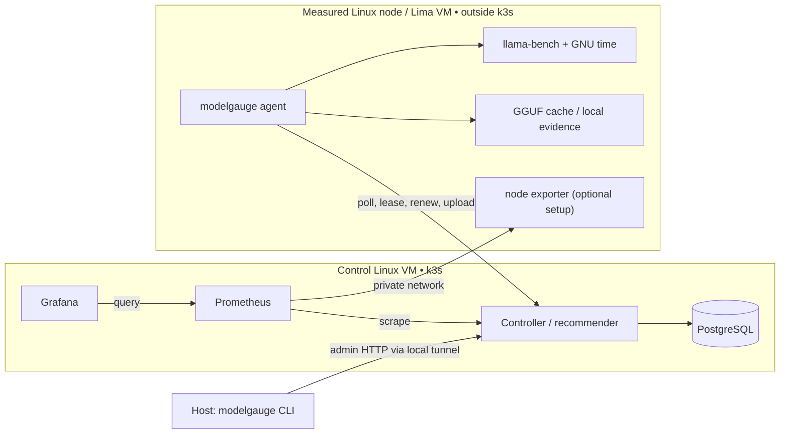

# 📊 ModelGauge

**Find out how fast an AI model runs on a node, how much memory it uses, and which measured configuration fits.**

ModelGauge is one Go executable with three roles: a host CLI, a controller in k3s,
and a Linux agent on each measured node. It benchmarks GGUF models with CPU-only
`llama.cpp`, stores results in PostgreSQL, and provisions Prometheus/Grafana.
Lima provides separate Linux control and benchmark VMs for local use.

## 🧭 Start here

| I want to… | Read |
|---|---|
| Run my first model experiment | [Getting started](docs/GETTING-STARTED.md) |
| Understand what runs where | [Architecture](docs/ARCHITECTURE.md) |
| Deploy control and benchmark VMs | [Control bootstrap](docs/deployment/BOOTSTRAP.md) · [Node bootstrap](docs/deployment/NODE-BOOTSTRAP.md) |
| Look up commands and examples | [CLI reference](docs/CLI.md) |
| Design a repeatable comparison | [Benchmark methodology](docs/BENCHMARKING.md) |
| Configure tokens, paths and services | [Configuration](docs/CONFIGURATION.md) |
| Export metrics and experiment evidence | [Export guide](docs/operations/EXPORT.md) |
| Remove only owned experiment resources | [Cleanup](docs/operations/CLEANUP.md) |
| Diagnose failures or preserve data | [Operations](docs/OPERATIONS.md) |
| Integrate with the controller | [HTTP API](docs/API.md) |
| Develop or test the project | [Contributing](CONTRIBUTING.md) |
| See remaining work | [Roadmap](docs/ROADMAP.md) |
| Package or publish binaries | [Release guide](docs/releases/RELEASING.md) |

## ✅ What works today

- Create/reuse a Lima control VM running k3s, PostgreSQL, the controller, Prometheus and Grafana.
- Provision a separate Linux benchmark VM with a pinned CPU-only `llama-bench` runtime and a persistent agent.
- Resolve catalog models, download checksum-verified GGUF files remotely, and inventory installed models.
- Generate per-model plans and multi-model campaigns with thread/context matrices.
- Measure prompt processing, generation throughput and peak resident memory; retain raw evidence on the node.
- Query results and deterministic, evidence-linked thread/memory recommendations.
- Recover interrupted work using leases, checkpoints and a durable agent journal; cancel queued or active jobs.
- Current source builds export results as JSON/CSV, current metrics, optional Prometheus history and verified raw evidence.
- Current source builds track bootstrap ownership and support scoped cleanup/dry runs; this is not included in v0.1.0.
- Build macOS/Linux ARM64/AMD64 release artifacts and matching digest-pinned controller metadata.

**Latest release:** [v0.1.0](https://github.com/ashwat287/modelGauge/releases/tag/v0.1.0).
The release includes macOS/Linux ARM64/AMD64 executables, checksums, and a public
multi-architecture controller image pinned by digest. See the
[installation guide](docs/releases/RELEASING.md) to use a downloaded CLI without Go or
Docker Desktop on the host. Source development remains documented below.
The downloaded CLI passed a fresh-VM release validation,
including model installation, execution, results, recommendation and Grafana data.
The earlier development VMs have not been migrated automatically.

## 🚀 Quick start from source

Run these commands from the repository root on a host with **Go 1.23 or newer**,
**Lima**, and internet access. The module may select its declared Go toolchain.
Use an absolute checkout path with `--source` if you run elsewhere. Docker Desktop
is not required: development bootstrap imports a locally built OCI image into k3s.

```sh
go build -o bin/modelgauge ./cmd/modelgauge
export PATH="$PWD/bin:$PATH"
modelgauge --help

# Separate VMs: control services and measured workload.
modelgauge control bootstrap --provider lima --source .
modelgauge node bootstrap --provider lima --name benchmark-node --source .
modelgauge node status benchmark-node

# Queue the download on the node, rather than on this host.
modelgauge model install qwen2.5-1.5b-instruct:q4_k_m --node benchmark-node
```

The install command returns a JSON `job_id`. Use that value in the next command;
wait for `completed`, then confirm the model appears in inventory:

```sh
modelgauge model install status JOB_ID
modelgauge model list --node benchmark-node

# Start small: one context, two thread counts, one model.
modelgauge benchmark campaign create \
  --node benchmark-node --execution-mode lima-linux \
  --models qwen2.5-1.5b-instruct:q4_k_m \
  --contexts 512 --threads 1,2 --output campaigns/first --submit

modelgauge benchmark campaign status --file campaigns/first/campaign.json
modelgauge results show --node benchmark-node
modelgauge results recommend \
  --node benchmark-node --model qwen2.5-1.5b-instruct:q4_k_m \
  --execution-mode lima-linux --context 512 --memory-budget-gib 2
modelgauge monitoring open
```

Poll campaign status until its plans finish before requesting a recommendation.
`JOB_ID` is a placeholder; never reuse IDs from historical validation records.
See the [full tutorial](docs/GETTING-STARTED.md) for expectations and troubleshooting.

## 🏗️ Architecture at a glance



A **measured node** is the Linux execution environment being characterized.
The benchmark node does **not** join k3s. The recommender is controller code,
not a separate service. A VM separates processes and memory allocation, but
VMs on the same laptop still share physical memory bandwidth, storage and heat.
For reliable laptop measurements, keep the control plane on your other machine.

## 💻 Resource planning

| New VM defaults | vCPUs | RAM | Disk |
|---|---:|---:|---:|
| Control plane | 4 | 6 GiB | 50 GiB |
| Benchmark node | 2 | 3 GiB | 30 GiB |

These are allocations, not measured steady usage. Resource flags affect new VMs
only. Two default VMs need more memory than an 8 GiB laptop can comfortably
provide alongside its host OS. For your Intel MacBook Air, place the control VM
on the stronger laptop and budget a benchmark VM conservatively. The current
bootstrap connects a locally managed Lima target; cross-host enrollment is a
manual Linux-agent workflow. See [architecture](docs/ARCHITECTURE.md).

## 📏 What the numbers mean

- **Prompt tokens/s:** throughput for processing a prompt of the recorded length.
- **Generation tokens/s:** decode throughput for the recorded synthetic workload.
- **Peak RSS:** the measured process's maximum resident memory, reported in bytes.
- **Reservation:** peak RSS multiplied by 1.25, rounded upward; a heuristic, not a universal fit guarantee.
- **Stable case:** standard deviation / average throughput is at most 10% in the current recommender.

Warm-up is a fixed number of runs, not a thermal-equilibrium detector. Memory is
measured for one recorded workload, not every context automatically. Prompt and
generation tests do not measure answer quality, HTTP latency, or concurrent serving.
Read [methodology](docs/BENCHMARKING.md) before comparing machines or runtimes.
The [historical benchmark report](docs/HISTORICAL-BENCHMARKS.md) preserves earlier
Linux VM measurements and their original evidence.

## 🧰 Repository map

```text
cmd/modelgauge/          executable entry point
internal/cli/           commands and human help
internal/control/       Lima bootstrap, images, local forwarding
internal/agent/         polling, Linux service management, recovery
internal/benchmark/     llama-bench execution and evidence collection
internal/controller/    PostgreSQL store, queueing, migrations, recommendations
internal/modelcache/    catalog and checksum-verified downloads
internal/server/        authenticated HTTP routes
internal/releases/      matching release resolution and downloads
internal/platform/      Linux facts, locks, atomic file operations
internal/profile/       standard-cpu plan generation
pkg/protocol/           versioned shared plan/result contracts
deploy/                 embedded k3s, monitoring and dashboard assets
tools/release/          cross-platform binaries and release manifests
docs/                   usage, architecture and operator guides
  deployment/           control/node bootstrap and manual k3s deployment
  operations/           monitoring and job recovery
  releases/             publishing and validation records
  HISTORICAL-BENCHMARKS.md archived Linux measurements and source evidence
```

## ⚠️ Current boundaries

Linux is the measured runtime; macOS runs the CLI and hosts Linux through Lima.
CPU GGUF/llama.cpp is the supported profile. GPU support, model-quality scoring,
production TLS/enrollment/credential rotation, automatic upgrades, evidence-bundle
export and general remote cluster lifecycle are future work. Authentication uses
shared development tokens. Keep this deployment on trusted networks.

Full history belongs in PostgreSQL; raw files remain on the measured node.
Monitoring gauges show selected/latest measurements, not a replacement for the
experiment record. There is no high-availability or automatic backup setup.
