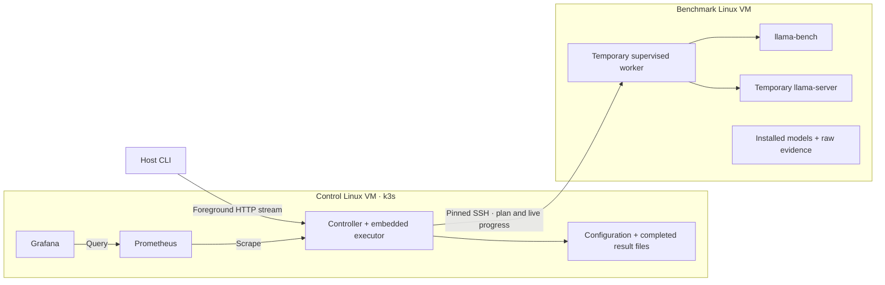

# 📊 ModelGauge

Benchmark GGUF models on a Linux node before deploying them: measure **throughput, request latency, and memory use**, then view results in Grafana or export them.

One installed Go executable provides the CLI, controller, and temporary node workers. A workspace has one control VM, one benchmark VM, and one selected model. You can install several models and benchmark them one at a time.

**Commands run in the foreground.** There is no application database, job queue, background polling agent, automatic retry, or execution recovery. Run one command at a time; overlapping commands are not protected by execution locks and may interfere.

## 🚀 Install from source

Build requirements: **Go 1.23.6+**, **Git**, and **Make**. Running the installed tool requires **Lima** (`limactl` on PATH, virtualization working) and internet access for VM images, guest packages, llama.cpp, container images, and models.

```sh
git clone https://github.com/ashwat287/modelGauge.git
cd modelGauge

make build       # Build CLI with embedded Linux ARM64/AMD64 runtimes
make test        # Run race tests, standalone-binary checks, and go vet
make install     # Install to ~/.local/bin/modelgauge
export PATH="$HOME/.local/bin:$PATH"
```

Keep the PATH export in your shell profile if needed. For another installation directory, use `make install BINDIR=/your/bin`.

After installation, the CLI works from any directory, even if you delete the checkout. Host Go, Git, and Make are no longer needed. Keep your benchmark YAML and exports outside the checkout.

## 🏗️ Prepare the workspace

```sh
mkdir -p "$HOME/modelgauge-lab"
cd "$HOME/modelgauge-lab"
modelgauge setup
```

`setup` provisions the VMs and services; it is separate from installing the host CLI. It prints progress and waits for completion. Initial setup downloads dependencies and builds pinned CPU-only llama.cpp binaries in the benchmark VM. Docker Desktop is not required.

| Default VM | CPUs | RAM | Disk |
|---|---:|---:|---:|
| `modelgauge-control` | 4 | 6 GiB | 50 GiB |
| `benchmark-node` | 2 | 3 GiB | 30 GiB |

Allow memory for the host OS **in addition to the 9 GiB allocated to VMs**. The default setup is too large for an 8 GiB laptop. For a different allocation:

```sh
modelgauge setup --control-memory 4 --node-memory 4 --node-cpus 2
```

Resource flags affect new VMs; they do not resize existing ones. Connection details and scoped ownership records are stored privately under `~/.config/modelgauge/`.

**Existing PostgreSQL-based workspaces:** export anything valuable and clean up using the previous version before installing this version. There is no database-history migration; use fresh VMs for validation.

## 🧪 Install a model and run an experiment

```sh
modelgauge model search qwen
modelgauge model install qwen2.5-1.5b-instruct:q4_k_m
```

Installation downloads to the benchmark node, verifies the checksum, and returns when complete. The progress state is printed once:

```text
Installation: running
Installation: completed
```

The initial catalog provides Qwen2.5 1.5B Instruct Q4_K_M, Q5_K_M, and Q8_0. For another compatible GGUF model:

```sh
modelgauge model install my-model:q4 --url "$MODEL_URL" --sha256 "$MODEL_SHA256"
```

Save this workload as `benchmark.yaml` in your working directory:

```yaml
apiVersion: modelgauge.io/v1alpha1
kind: Benchmark
metadata:
  name: baseline
spec:
  threads: [1, 2]
  contexts: [512]
  stages:
    - profile: standard-cpu
      options:
        warmups: 3
        repetitions: 5
    - profile: node-serving
      options:
        warmups: 2
      config:
        suite: basic
        concurrency: [1, 2]
        requests: 10
        output_tokens: 128
```

```sh
modelgauge validate benchmark.yaml &&
modelgauge run benchmark.yaml
```

The YAML describes the workload; the controller resolves the registered node and selected model. `validate` previews it. `run` prints `running` once, shows new phase messages as they occur, and prints `completed` when finished. Errors return a nonzero exit code. There is no status command to poll.

| Profile | Measurements |
|---|---|
| `standard-cpu` | Prompt throughput at each context/thread setting, generation of 128 tokens, throughput variation across repetitions, and peak RSS in a separate memory workload. |
| `node-serving` | Temporary model-server startup/shutdown, request latency, time to first token, generation timing, request throughput/outcomes, and available process-resource measurements. |

For `node-serving`, `suite: deployment` adds sustained load, burst/recovery probes, cache or conversation cases, output-format checks, cancellation, and idle/resume measurements. These are inference tests, not job recovery. Request counts use `config.requests`; `options.repetitions` belongs to direct throughput profiles.

For scripts, `run --json` and `model install --json` write their final result to stdout, with progress on stderr. Ctrl+C cancels the foreground request and asks the controller to stop its worker. Connection loss also causes the worker to stop through its keepalive supervision. Interrupted downloads are discarded, interrupted benchmarks do not resume, and the user reruns the operation from the beginning.

To compare another installed model:

```sh
modelgauge model list
modelgauge model use qwen2.5-1.5b-instruct:q4_k_m
modelgauge run benchmark.yaml
```

## 📈 Results, monitoring, and export

```sh
modelgauge results
modelgauge results --json
modelgauge history
modelgauge results recommend --context 512 --memory-budget-gib 2
modelgauge monitoring open

modelgauge export --output ./exports/baseline --include-raw
```

Only completed measurements are retained in the controller's persistent files. `results` and `export` use the latest completed run by default; `--experiment NAME` selects completed history. Recommendations use stable measured throughput and a memory margin, not model-quality scores or guaranteed production capacity.

Exports contain JSON/CSV measurements, plans/results, current metrics, a manifest, and checksums. `--include-raw` retrieves raw evidence from the benchmark VM. Prometheus time-series history is optional; see `modelgauge export --help` for its URL/time-range flags.

Grafana opens at `http://127.0.0.1:3000`, with username `admin` and a generated password. For the default control VM:

```sh
limactl shell --workdir / modelgauge-control -- sh -lc '
  kubectl --kubeconfig "$HOME/.kube/modelgauge-config" \
    -n monitoring get secret grafana-admin \
    -o jsonpath="{.data.password}" | base64 --decode
  printf "\n"
'
```

Prometheus collects active-operation/completed-benchmark metrics and configured Linux node-exporter metrics. It does not automatically monitor every macOS host process.

## 🔌 Architecture



The executor lives inside the controller. A restricted, host-key-pinned SSH command starts the worker, which never calls the controller. The benchmark node needs neither k3s nor a resident agent.

Stages execute in order: `llama-bench` exits before the temporary loopback-only `llama-server` starts. Owned process groups are stopped and reaped on cancellation. Benchmark modules own planning, execution, reports, and metrics; provisioning and transport carry their common plan/result envelopes.

No operation is restored after a controller restart. Completed results and configuration remain. Ownership records protect scoped cleanup; they do not resume experiments.

Both VMs share host CPU, memory bandwidth, and thermal limits. Measurements describe the Linux guest, not native macOS performance. Warmups alone do not establish thermal stability; compare repeated runs under similar host load and power conditions.

## 🧹 Cleanup and troubleshooting

```sh
modelgauge cleanup --dry-run            # Preview; make no changes
modelgauge cleanup                      # Refuse known active work
modelgauge cleanup --force              # Stop owned work, then clean
modelgauge cleanup --delete-vms         # Delete owned VMs when idle
modelgauge cleanup --force --delete-vms # Stop owned work and delete created VMs
```

Cleanup prints plain text by default. For example, after `cleanup --force --delete-vms`:

```text
modelgauge-control: VM removed.
benchmark-node: VM removed.
Cleanup completed.
```

Without `--delete-vms`, the summary says that managed files and services were removed and the VM was kept. A dry run starts with `Dry run: no changes made.` and reports planned actions or checks still required. Repeated cleanup reports already-absent VMs or `Nothing to clean.`

For scripts, request JSON explicitly:

```sh
modelgauge cleanup --dry-run --json
```

Normal cleanup returns an error if owned work is active and suggests `--force`. Force stops that work before removing resources; it does not expand the scope of deletion.

Export what you want to keep first. Managed models and evidence can be removed even when VMs are retained. VM deletion removes their entire disks, including completed results and monitoring data. Host exports remain available; reused and untracked VMs are preserved.

Force still checks ownership and guest identity, requires a reachable controller to stop managed work, and does not kill unrelated model processes. `--force --dry-run` is read-only. Activity checks are best-effort: without execution locks, concurrent commands can race and interfere. Do not issue overlapping commands.

For an SSH connection error, fix the VM/network problem, refresh registration, then rerun the failed command:

```sh
modelgauge node reconnect
```

Reconnect does not restart a broken VM or resume work. For upgrades, install from a new checkout and rerun `modelgauge setup` while idle. Use `modelgauge --help` and `<command> --help` for command flags.
