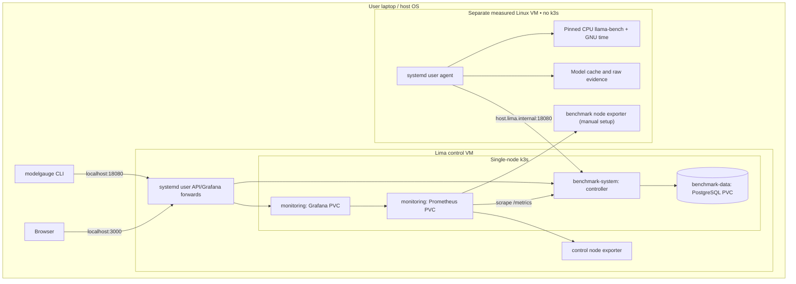
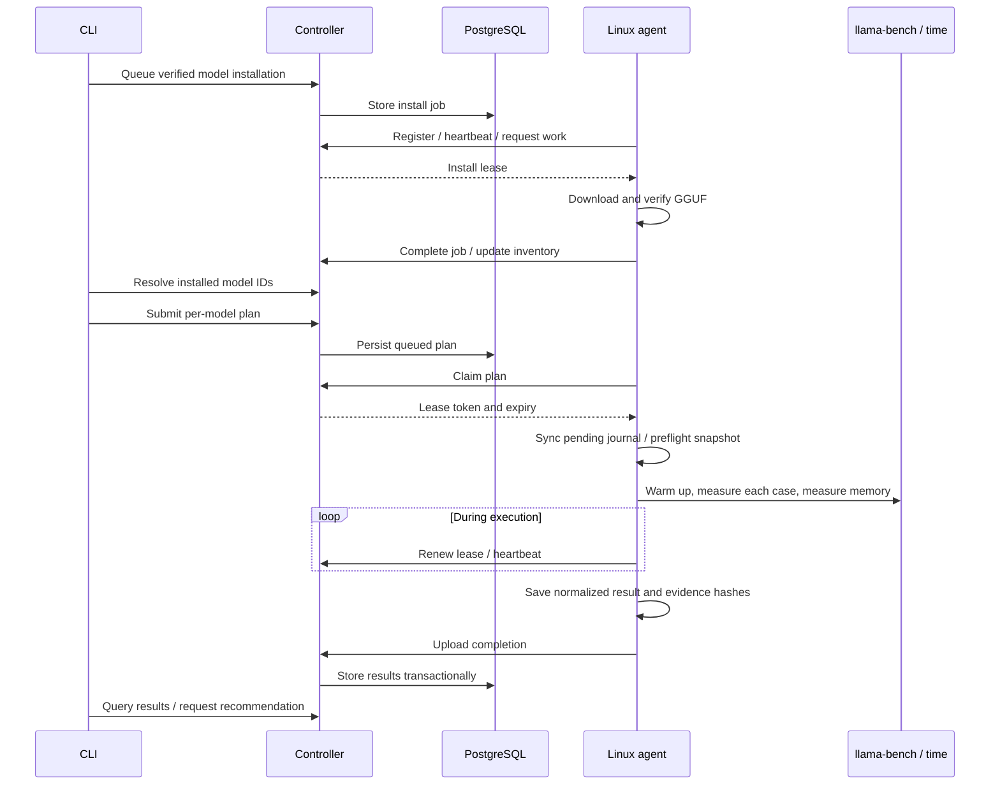

# 🏗️ Architecture and boundaries

[Documentation home](../README.md) · [Configuration](CONFIGURATION.md) · [HTTP API](API.md)

## 🧩 Top-level components

| Component | Runs where | Owns |
|---|---|---|
| CLI | User's macOS/Linux host | Bootstrap, catalog commands, plan generation, queries |
| Controller | `benchmark-system` in control k3s | Authenticated API, queue claims, renewal, results, recommendations |
| PostgreSQL | `benchmark-data` in control k3s | Durable node/job/plan/result records and migrations |
| Prometheus | `monitoring` in control k3s | Scraped operational, result and Linux VM metrics |
| Grafana | `monitoring` in control k3s | Provisioned dashboards and Prometheus queries |
| Agent | Measured Linux node, outside k3s | Registration, polling, recovery, download and execution ownership |
| llama-bench / GNU time | Child processes on the measured node | Throughput samples and maximum process RSS |
| GGUF/evidence storage | Measured node's filesystem | Verified models, raw JSON, snapshots, checkpoints, pending upload journal |
| Node exporter | Linux VM user service | Linux CPU, memory, disk and system metrics |

Analysis/recommendation logic is part of the controller process. There is no
separate scheduler service, recommender deployment, object store or message
broker. PostgreSQL provides queue coordination; agents initiate HTTP requests.

## 🗺️ Deployment layout

The agent's connection passes through the host's forwarded control API in the
local Lima flow; the diagram simplifies those forwarding hops. Keep both host
and control VM running. The CLI saves the active connection privately and uses
it for later commands. Release binaries resolve a matching controller image and
Linux agent; development builds compile them from `--source`.

## 🔄 Experiment lifecycle

The agent serializes model installation and benchmarks on the node. The database
serializes claims across both queues; host/user locks also protect direct runs.
Two different Unix users or external workloads can still interfere. See
[job recovery](operations/JOB-RECOVERY.md) for interruption and cancellation semantics.

## 🧱 Isolation and measurement identity

- **VM boundary:** separate Linux kernels, assigned vCPUs and RAM; not separate physical memory buses or cooling.
- **Container/namespace boundary:** control services have independent processes, Kubernetes objects and resource limits. A namespace alone is not a security boundary.
- **Node boundary:** the agent records Linux CPU count, architecture, RAM, node ID and execution mode.
- **Experiment boundary:** plan IDs, model checksum, runtime checksum, case shape, samples and raw evidence identify each run.

`lima-linux` and `native-isolated` are separate result identities. The latter is
a label plus application locks; it does not automatically create cgroups,
exclusive CPU affinity or a dedicated physical machine. Do not treat a Mac-hosted
Linux VM result as native macOS/Metal performance. Apple Silicon VM results are
not transferable to the Intel Air.

## 💾 Data and persistence

| Data | Location | Persistence / limitation |
|---|---|---|
| Control connection/tokens | Host `~/.config/modelgauge/control.json` | Owner-only file; active connection, not a multi-cluster catalog |
| Plans, installs, normalized results | PostgreSQL 12 Gi PVC | Single local-path volume; backup is operator-owned |
| Full raw benchmark JSON/timing | Measured node results directory | Kept locally; API stores artifact names and hashes, not raw-file uploads |
| GGUF downloads | Measured node managed model cache | Checksum verified; partial download recovery |
| Prometheus data | 4 Gi PVC | Retention 7 days or 2 GB of samples |
| Grafana state | 1 Gi PVC | Dashboard provisioning comes from embedded assets |

Local-path storage is tied to the VM/node. Recreating a cluster on a different
machine does not restore these volumes. Database restore alone does not recreate
raw evidence or the model cache.

## 🌐 Network and trust

| Endpoint | Default | Purpose |
|---|---|---|
| Host API tunnel | `127.0.0.1:18080` | Host CLI access |
| Controller service | guest NodePort `31080`, container `8080` | Private node access / cluster routing |
| Host Grafana tunnel | `127.0.0.1:3000` | Dashboard |
| Prometheus service | cluster port `9090` | Scrape store/query API; optional manual forward |
| Node exporter | private VM IP `9100` | Linux telemetry |
| PostgreSQL | cluster port `5432` | Internal controller storage |

The default service has a NodePort as well as loopback forwarding. Actual
reachability depends on VM networking and host routing. Tokens distinguish admin
and agent requests; the current agent credential is shared. `/healthz` and
`/metrics` are unauthenticated. Production TLS, per-node enrollment, token rotation,
network-policy hardening and signed artifacts remain future work.

## 🧮 Recommendations

The controller selects the latest completed run for the node/model/mode with a
prompt-only case at the exact requested context. Among stable cases in that run,
it chooses the fastest prompt and generation thread counts separately. It uses
that run's memory reservation and the caller's usable RAM budget to classify fit.
It does not train a predictor, benchmark answer quality, or actively place serving
workloads onto Kubernetes. See [methodology](BENCHMARKING.md) for limitations.

## 🖥️ Moving to another machine

Keep the same plan structure and model/runtime revisions, but register a distinct
node identity for different hardware or execution modes. On the 8 GiB Intel Air,
run only the measured workload environment and host control services elsewhere.
For a remote Linux node, transfer a matching Linux executable and use the manual
agent enrollment described in [configuration](CONFIGURATION.md). The controller
must have a reachable private endpoint; `host.lima.internal` is only appropriate
for the local Lima topology, not an arbitrary remote laptop.
