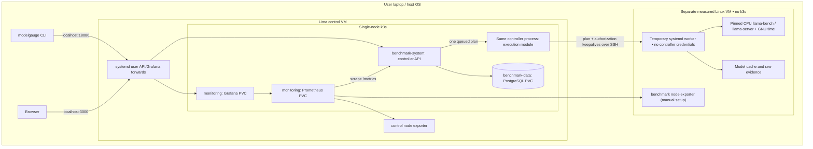
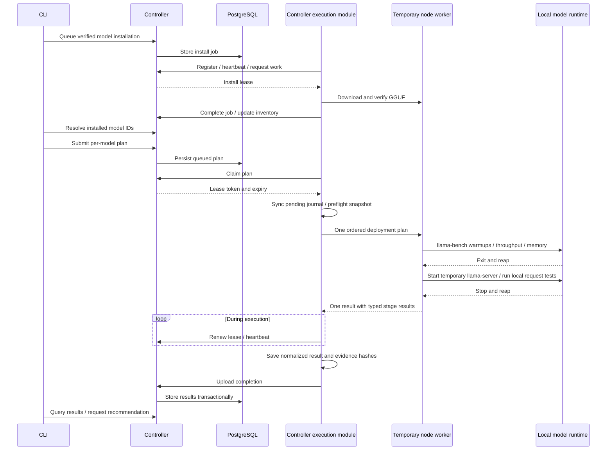

# 🏗️ Architecture and boundaries

[Documentation home](../README.md) · [Configuration](CONFIGURATION.md) · [HTTP API](API.md)

## 🧩 Top-level components

| Component | Runs where | Owns |
|---|---|---|
| CLI | User's macOS/Linux host | Bootstrap, catalog commands, plan generation, queries |
| Controller | `benchmark-system` in control k3s | Authenticated API, queue claims, renewal, results, recommendations |
| PostgreSQL | `benchmark-data` in control k3s | Durable node/job/plan/result records and migrations |
| Prometheus | `monitoring` in control k3s | Scraped operational, result and Linux VM metrics |
| Grafana | `monitoring` in control k3s | Provisioned dashboards and Prometheus queries |
| Execution module | Inside the controller process in k3s | Registration, polling, leases, recovery and result uploads |
| Temporary worker | Measured Linux VM, supervised by a transient systemd unit | Execute one authorized operation, hold the execution lock, clean up owned processes |
| Benchmark modules | Temporary worker on the measured node | Plan validation, workload execution, measurements, CSV and metric formatting |
| llama-bench / GNU time / llama-server | Owned child processes on the measured node | Direct throughput/RSS or temporary local model serving |
| GGUF/evidence storage | Measured node's filesystem | Verified models, raw JSON, snapshots and checkpoints; upload journal stays on the controller PVC |
| Node exporter | Linux VM user service | Linux CPU, memory, disk and system metrics |

Analysis/recommendation logic is part of the controller process. There is no
separate scheduler service, recommender deployment, object store or message
broker. PostgreSQL provides queue coordination; the embedded executor reuses the controller lease API over loopback.

## 🗺️ Deployment layout

The controller starts its execution module automatically. There is no host poller
and no `limactl` dependency inside the pod. The module uses Go SSH to reach the
node through Lima's existing host-loopback SSH forward. Bootstrap discovers the
port and control VM gateway, generates a dedicated key and pins the guest host
key. The host CLI can exit after submitting work; Lima and both VMs must remain
running. No additional application process runs on the host.

Connections, private keys and pending upload journals are stored privately on the
controller's 1 GiB `modelgauge-executor-data` PVC. The measured node has only the
restricted public key, worker/runtime binaries, GGUF files and raw evidence.
The key permits only starting/stopping owned worker units; no arbitrary shell or
SSH forwarding. Ordinary user SSH keys are preserved during rotation and cleanup.

## 🔄 Experiment lifecycle

The embedded executor serializes model installation and benchmarks. The node worker
holds a single execution lock across the entire plan. The database
serializes claims across both queues; host/user locks also protect direct runs.
Two different Unix users or external workloads can still interfere. See
[job recovery](operations/JOB-RECOVERY.md) for interruption and cancellation semantics.

## 📋 Declarative submission boundary

The CLI strictly decodes `Benchmark` YAML and sends its versioned specification to
`POST /v1/experiments`. The controller resolves every node/model pair from inventory,
compiles stages through the registry, and freezes the plans plus job IDs in
PostgreSQL. That record and all queued jobs commit together. Concurrent/repeated
applies of the same name/specification return the saved jobs; edits under the same
name fail. CLI-local receipts are not needed. Status/cancel read the saved record;
cancel uses existing job lease cancellation. No watcher, CRD or new service exists.

## 🧩 Benchmark module boundary

`internal/benchmark/registry.go` registers each module's profile planner, validation,
runner and optional CSV/Prometheus formatting. The CLI enumerates these profiles and
passes each YAML stage’s `config` to that module unchanged. The embedded executor passes the generic plan to the temporary worker; the controller
stores the generic report envelope; exports ask the registry for additional reports.
Adding/removing a benchmark requires its module/tests and one registry entry, rather
than new CLI branches, agent logic, database columns or Kubernetes resources.

The benchmark module owns its planners and runtime-specific types. Its external
execution interface is `Run(ctx, plan, Options)`; there is no separate profile
package or second execution entry point. Callers use the declaration API, generic
validation and registry reporting functions without knowing llama-bench/server
configuration or report structures. SSH work/stop operations likewise share one
private session lifecycle that owns cancellation and connection cleanup.

The YAML declaration selects ordered profiles; `deployment` is a convenience profile: one direct `llama-bench` stage followed by
one managed serving stage per thread setting, all for the same model/checksum.
Stages run synchronously under one lock. Every stage must exit successfully and
leave no model process behind before the next starts. A failure or cancellation
stops the plan. Existing model processes make the node busy; they are never killed.
`standard-cpu` and `node-serving` remain available for independent experiments.

The outer result keeps engine cases/RSS for existing fit analysis and separately
typed stage reports for request latency, load and resources. Suite CSV exports
include each stage's full JSON; Prometheus serving series include a stage label.
Historical reports and existing direct plans remain readable.

The worker runs in an owned transient systemd service with cgroup cleanup and a
24-hour hard runtime ceiling. Keepalives arrive every five seconds; EOF or twenty
seconds without authorization cancels the operation. Controller lease loss cancels
the executor's connection and stops its owned unit. Model processes and local load
generation remain inside the measured VM. The controller stores its pending journal
under `/var/lib/modelgauge/runs/NODE`; raw evidence stays inside the VM.
A completed result is reused for upload retries instead of repeating measurements.
On interruption, completed stages are reused and unfinished serving stages restart
with a fresh model process. This may introduce a cooling gap between stages;
completed measurements retain their original timestamps.

The execution module starts with `modelgauge server` when `--executor-state-dir`
(or `MODELGAUGE_EXECUTOR_STATE_DIR`) is configured; the bundled deployment sets
`/var/lib/modelgauge`. It restores saved node connections after controller restarts.
Node bootstrap registers the connection automatically. Pauses used by upgrades
and cleanup survive restarts and refuse to interrupt pending work. The controller
uses one replica with Recreate updates so a replacement joins after its predecessor
has stopped. Node and journal locks also fence concurrent execution.

The old host `executor run` command is removed. Manually enrolled legacy Linux
agents remain compatible. Upgrading a managed idle node retires its old agent
service and private agent-token file.

## 🧱 Isolation and measurement identity

- **VM boundary:** separate Linux kernels, assigned vCPUs and RAM; not separate physical memory buses or cooling.
- **Container/namespace boundary:** control services have independent processes, Kubernetes objects and resource limits. A namespace alone is not a security boundary.
- **Node boundary:** the worker records Linux CPU count, architecture, RAM, node ID and execution mode.
- **Experiment boundary:** plan IDs, model checksum, runtime checksum, case shape, samples and raw evidence identify each run.

`lima-linux` and `native-isolated` are separate result identities. The latter is
a label plus application locks; it does not automatically create cgroups,
exclusive CPU affinity or a dedicated physical machine. Do not treat a Mac-hosted
Linux VM result as native macOS/Metal performance. Apple Silicon VM results are
not transferable to the Intel Air.

## 💾 Data and persistence

| Data | Location | Persistence / limitation |
|---|---|---|
| Control connection/tokens | Host `~/.config/modelgauge/control.json` | Owner-only file; active connection, not a multi-cluster catalog |
| Plans, installs, normalized results | PostgreSQL 12 Gi PVC | Single local-path volume; backup is operator-owned |
| Full raw benchmark JSON/timing | Measured node results directory | Kept locally; API stores artifact names and hashes, not raw-file uploads |
| GGUF downloads | Measured node managed model cache | Checksum verified; partial download recovery |
| Prometheus data | 4 Gi PVC | Retention 7 days or 2 GB of samples |
| Grafana state | 1 Gi PVC | Dashboard provisioning comes from embedded assets |

Local-path storage is tied to the VM/node. Recreating a cluster on a different
machine does not restore these volumes. Database restore alone does not recreate
raw evidence or the model cache.

## 🌐 Network and trust

| Endpoint | Default | Purpose |
|---|---|---|
| Host API tunnel | `127.0.0.1:18080` | Host CLI access |
| Controller service | guest NodePort `31080`, container `8080` | Private node access / cluster routing |
| Host Grafana tunnel | `127.0.0.1:3000` | Dashboard |
| Prometheus service | cluster port `9090` | Scrape store/query API; optional manual forward |
| Node exporter | private VM IP `9100` | Linux telemetry |
| PostgreSQL | cluster port `5432` | Internal controller storage |

The default service has a NodePort as well as loopback forwarding. Actual
reachability depends on VM networking and host routing. Tokens distinguish admin
and agent requests; the current agent credential is shared. `/healthz` and
`/metrics` are unauthenticated. Production TLS, per-node enrollment, token rotation,
network-policy hardening and signed artifacts remain future work.

## 🧮 Recommendations

The controller selects the latest completed run for the node/model/mode with a
prompt-only case at the exact requested context. Among stable cases in that run,
it chooses the fastest prompt and generation thread counts separately. It uses
that run's memory reservation and the caller's usable RAM budget to classify fit.
It does not train a predictor, benchmark answer quality, or actively place serving
workloads onto Kubernetes. See [methodology](BENCHMARKING.md) for limitations.

## 🖥️ Moving to another machine

Keep the same plan structure and model/runtime revisions, but register a distinct
node identity for different hardware or execution modes. On the 8 GiB Intel Air,
run only the measured workload environment and host control services elsewhere.
For a remote Linux node, transfer a matching Linux executable and use the manual
agent enrollment described in [configuration](CONFIGURATION.md). The controller
must have a reachable private endpoint; `host.lima.internal` is only appropriate
for the local Lima topology, not an arbitrary remote laptop.
